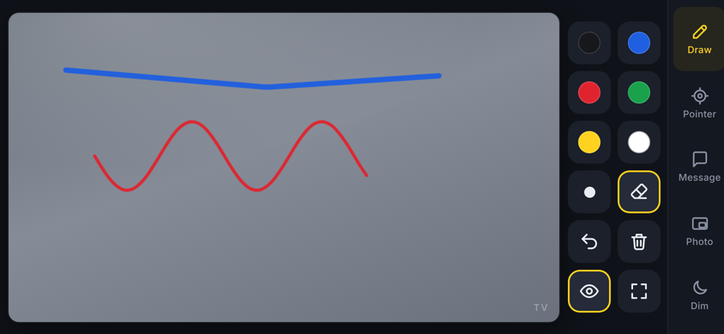
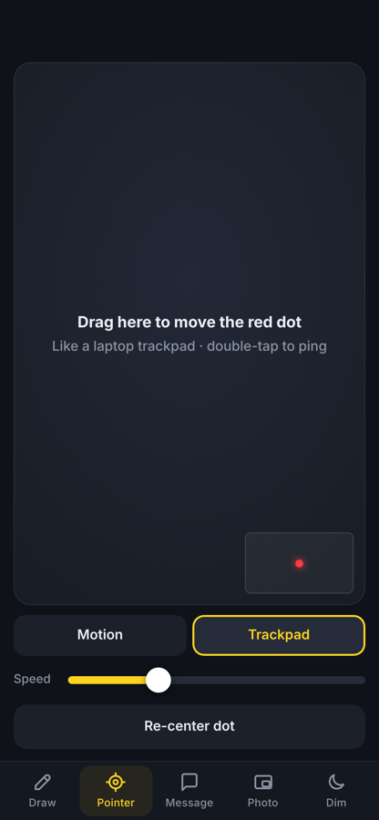
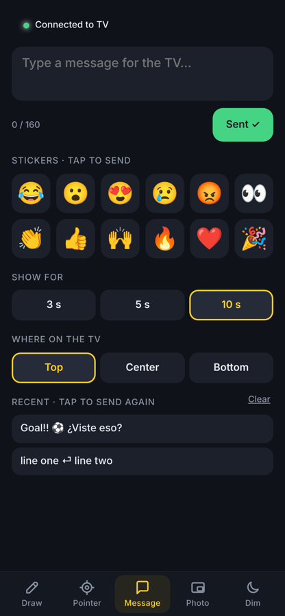
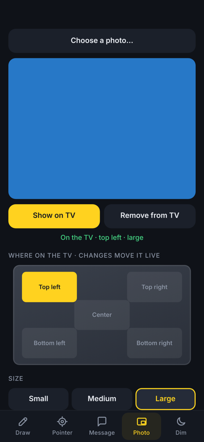
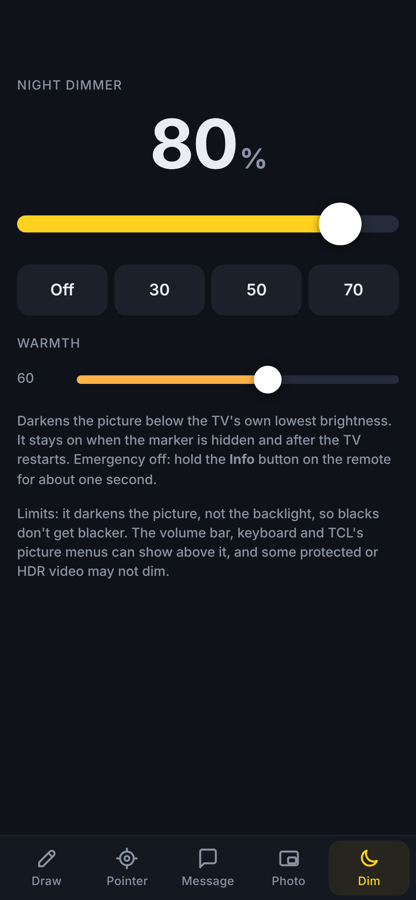

# TV Overlay Suite

Draw, point, dim the screen and send messages or photos to your **Android TV / Google TV** from your phone — over
whatever is playing.

No account, no cloud, no app on the phone: the TV serves a small web page on your home network and you open it in
Chrome by scanning a QR code.

<!-- docs/demo.gif: drawing over a video (to be added) -->

## Features

| | |
|---|---|
| **Marker** | Draw over anything playing, in six colours and three sizes, with eraser and undo. The remote's **Info** button (or any button you choose) shows or hides the layer. Several phones can draw at once. |
| **Night dimmer** | A 0–90 % black layer with optional warmth, for late-night viewing. Survives a reboot. Holding the remote button for about a second turns it off. |
| **Send to screen** | Short text messages or big emoji stickers that pop up for 3, 5 or 10 seconds, at the top, centre or bottom. |
| **Laser pointer** | A red dot you move with **Motion** (point the phone at the TV; your finger only switches the laser on) or **Trackpad** mode. Double-tap to ping. |
| **Photo picture-in-picture** | Pick a photo on the phone and show it in a rounded box in a corner or the centre, size S / M / L, moved live. It sits under the ink, so you can draw on it. |

The screen stays awake while a phone is connected and a layer is showing.

### The phone page

<p>

</p>
<p>




</p>

## Requirements

- An **Android TV or Google TV** running Android 8.0 or newer.
- A phone on the **same Wi-Fi** as the TV, with **Chrome** (recommended; Motion pointing needs it).
- Only tested so far on one TV (see [Tested on](#tested-on)); reports from other models are welcome.

## Install

The app is not on Google Play yet. Get the APK from the
[latest release](https://github.com/TVOVERLAYSUITE/tv-overlay-suite/releases/latest).

**With the Downloader app (no computer)**
1. On the TV, install **Downloader** (by AFTVnews) from Google Play.
2. Settings → Apps → Security & restrictions → **Unknown sources** → switch **Downloader** on.
   (On some TVs: Settings → Privacy → Security & restrictions.)
3. In Downloader, open `github.com/TVOVERLAYSUITE/tv-overlay-suite/releases`, choose the newest
   `TV-Overlay-Suite-v….apk`, and install it.

**With adb (computer or Termux)**
```
adb connect <tv-ip>:5555
adb install TV-Overlay-Suite-v1.4.0.apk
```
or use [`tools/tvos-install.sh`](tools/tvos-install.sh), which also switches the service on:
`bash tvos-install.sh <tv-ip> TV-Overlay-Suite-v1.4.0.apk`

Check the download against `SHA256SUMS.txt` in the release, if you like:
`sha256sum -c SHA256SUMS.txt`

## Setup

The app draws over other apps through Android's **accessibility service**, which has to be switched on once.
Open **TV Overlay Suite** on the TV. It first explains, in plain words, what the service is used for (see
[Privacy](#privacy)); choose **Agree**.

**Step 1: turn on USB debugging (one time).**
Settings → System → About → select **Android TV OS build** 7 times until it says you are a developer. Then
Settings → System → **Developer options** → **USB debugging** → On.

**Step 2: press "Enable automatically".**
The app connects to the TV's own debugging service, the TV asks **"Allow USB debugging?"**, you tick
**Always allow** and choose **Allow**, and the service is on. The app also gives itself permission to switch the
service back on by itself after future updates, so you won't need to do this again.
You can switch USB debugging off afterwards if you like.

> On many TVs you can also go to Settings → Accessibility → TV Overlay Suite → On. On some (TCL, for example)
> that screen is empty, which is why the button exists.

<a id="setup"></a>
**If the button doesn't work.** Some TVs offer only **Wireless debugging** with a pairing code, which the button
does not support. From a computer, or from a phone with [Termux](https://termux.dev) and `android-tools`, run:
```
bash tools/tvos-install.sh <tv-ip> --enable
```
The TV's address is under Settings → Network & Internet → your Wi-Fi network.

## Using it

1. On the TV, open the app, or press **Info** to show the marker layer: either way a QR code appears.
2. Scan it with the phone. The page opens in Chrome, already **paired**.
3. Draw, point, dim, or send messages and photos from the tabs at the bottom (or on the right side in landscape).

**Remote button.** A short press shows or hides the marker layer. A long press (about one second) turns the night
dimmer off and removes the photo. Use **Set a different button** on the setup screen to choose another button.

**Pairing code.** Only phones that know the TV's 6-character code can connect. The QR code carries it, and the
setup screen shows it for typing on a phone that can't scan. The phone remembers it. **New pairing code**
disconnects every phone; they scan the new QR to come back.

### Motion pointing needs one Chrome setting

Chrome gives motion sensors only to secure (HTTPS) pages, and the TV's page is plain HTTP on your home network.
Trackpad mode works without this. To use Motion mode:

1. In Chrome on the phone, open `chrome://flags/#unsafely-treat-insecure-origin-as-secure`
2. In the text box, type the page's address exactly as the Pointer tab shows it, e.g. `http://192.168.1.23:8765`
3. Set it to **Enabled** and tap **Relaunch**.

If the TV's address changes, add the new one after a comma. The Pointer tab detects all of this and shows the
same steps with your exact address.

## Known limits

- The dimmer darkens the picture; it can't lower the backlight, so blacks don't get blacker.
- Some system screens (volume bar, keyboard, the TV's own picture menus) and some protected or HDR video can show
  above the overlay layers.
- Long press depends on the remote: some remotes don't report how long a button is held.
- The page talks to the TV over plain HTTP on your home network. The pairing code keeps other people on the same
  Wi-Fi from connecting, but the traffic itself is not encrypted. Use it on networks you trust.
- "Enable automatically" needs USB debugging on and the classic adb port (5555). Android may restrict on-device adb
  in future versions; the manual method above keeps working.

## Privacy

- The accessibility service is used **only** to catch the remote button you choose and to draw the app's layers
  over other apps. It does **not** read what is on the screen.
- The app collects no data and has no analytics. It does not use the internet. It only talks to phones on your home
  network that you pair with the code.
- Photos sent from a phone stay in the TV's memory only while they are shown, and are never saved or uploaded.
  Drawings stay in memory until you clear them or the TV restarts.

## Troubleshooting

| Problem | Fix |
|---|---|
| The phone page doesn't load | The phone must be on the same Wi-Fi as the TV (not mobile data, not a guest network that isolates devices). |
| "The TV did not accept that code" | The code was changed on the TV. Scan the new QR, or type the code from the setup screen. |
| "Too many wrong codes" | Five wrong codes lock that phone out for a minute. |
| "Could not reach the TV's debugging service" | USB debugging is off, or the TV only offers Wireless debugging. See [the manual method](#setup). |
| After an update the button does nothing | Open the app once; it switches the service back on. If that fails, press **Enable automatically** again. |
| Motion mode is greyed out | See [the Chrome setting](#motion-pointing-needs-one-chrome-setting). |

## Tested on

| TV | Android | Version | Result |
|---|---|---|---|
| TCL 55Q51K (Google TV) | 12 | 1.4.0 | Working: setup button, pairing, all tabs, re-enable after update |

Tried it on another TV? Please open an issue or a pull request adding a row.

## Building from source

No Gradle needed: `build.sh` runs aapt2, javac, d8, zipalign and apksigner from the Android SDK
(build-tools 34.0.0, platform 34) with Java 17 or newer.

```
export ANDROID_SDK=~/android-sdk
./build.sh                                  # test build, signed with a throwaway debug key
TVOS_KEYSTORE=release.p12 TVOS_KS_PASS=… ./build.sh   # release build
```

Tests:
```
bash test/run-tests.sh            # protocol, pairing, adb client, accessibility-list editing
python3 test/e2e.py <chrome-path> # two simulated phones against test/TestHost (see the file header)
```

How the pieces fit: `MarkerService` (accessibility service and window stack: dimmer < photo < ink < pop-ups <
pointer), `InkServer` (HTTP + WebSocket + pairing), `Ink` / `Extras` (protocol, documented at the top of each file),
`Enabler` + `Adb` (the "Enable automatically" button), `SetupActivity`, and `assets/index.html` (the phone page).

## License

[MIT](LICENSE). Includes the QR Code generator library by Project Nayuki (MIT); see [NOTICE](NOTICE).
Not affiliated with Google, Android or any TV maker.
